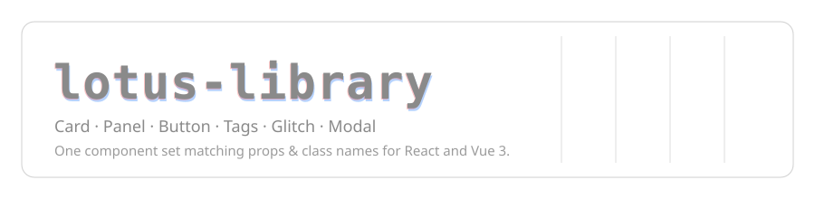

# @jdlanyon/lotus-library

[](https://github.com/JDLanyon/lotus-library/actions/workflows/ci.yml)
[](https://jdlanyon.dev/lotus-library/)


> ### ▶ [Open the live component showcase →](https://jdlanyon.dev/lotus-library/)
> Every component, prop and variant, rendered and interactive — no clone
> required.

<p align="center">
  <a href="https://jdlanyon.dev/lotus-library/">
    
  </a>
</p>

Reusable **Card**, **Panel**, **Button**, **Tags**, **Glitch** and **Modal**
components for reproducible custom websites. Ships **React** and **Vue 3**
bindings from a single package with matching props, class names and behaviour.

- **React** — used by `sausytime.com` (Next.js)
- **Vue 3** — used by `jdlanyon.dev` (VitePress) and other Vite sites
- Zero runtime dependencies beyond a React/Vue peer.
- Monochromatic by default; colour is reserved for the glitch effects.

> **New here, or an LLM?** Read [Component model](#component-model-when-to-use-what)
> and [Layout is the host's job](#layout-is-the-hosts-job) first — they define
> the library's boundaries and are the most common source of misuse.

## Install

This package is published to **GitHub Packages** (`npm.pkg.github.com`), which
requires authentication to install. Add a committed `.npmrc` at your repo root:

```
@jdlanyon:registry=https://npm.pkg.github.com
//npm.pkg.github.com/:_authToken=${NPM_GITHUB_TOKEN}
```

`NPM_GITHUB_TOKEN` is a classic GitHub PAT with **`read:packages`**, supplied via
the environment (never commit the token). In GitHub Actions use the built-in
`${{ secrets.GITHUB_TOKEN }}`. On a fresh machine you can instead run
`npm login --scope=@jdlanyon --registry=https://npm.pkg.github.com` once.

```bash
npm install @jdlanyon/lotus-library
```

Import the stylesheet once at your app root:

```ts
import '@jdlanyon/lotus-library/style.css';
```

## Components

| Component      | React | Vue | Purpose                                                   |
| -------------- | :---: | :-: | --------------------------------------------------------- |
| `Card`         |  ✅   | ✅  | Dated/tagged content card (thumbnail, title, tags, link)  |
| `CardGrid`     |  ✅   | ✅  | Convenience: maps items → `Card`s, owns one `ProjectModal`|
| `Panel`        |  ✅   | ✅  | A single linked card with thumbnail, title, description   |
| `PanelGrid`    |  ✅   | ✅  | Responsive flex-wrap grid that lays out `Panel`s          |
| `Tags`         |  ✅   | ✅  | Row of small tag chips                                    |
| `Button`       |  ✅   | ✅  | Blocky hover-invert button / link                         |
| `GlitchLink`   |  ✅   | ✅  | Link with a chromatic-aberration glitch on hover          |
| `GlitchText`   |  ✅   | ✅  | Animated glitching text                                   |
| `GlitchImage`  |  ✅   | ✅  | Animated glitching image                                  |
| `Glitch`       |  ✅   | ✅  | Low-level glitch engine (effects, name cycler)            |
| `Modal`        |  ✅   | ✅  | Pure modal shell (slot/prop driven, no fetching)          |
| `ProjectModal` |  ✅   | ✅  | `Modal` wrapper that fetches a `/projects/:slug` page     |
| `Nav` / `Footer` | ✅ | ✅  | Optional site chrome (logo, links, theme switch)          |
| `Embed`        |  ✅   | ✅  | Responsive 16:9 iframe (e.g. YouTube)                     |
| `Tooltip`      |  ✅   | ✅  | Hover tooltip wrapping arbitrary content                  |
| `TypeWriter`   |  ✅   | ✅  | Cycling typewriter heading                                |

## Component model (when to use what)

The library exposes **three** content surfaces. Pick by size and intent — they
are layers of the same idea (a clickable surface), not alternatives:

| Surface  | Size / intent                              | Use for                              |
| -------- | ------------------------------------------ | ------------------------------------ |
| `Button` | **Small**, few words                        | Actions, links, "Open", "View →"     |
| `Card`   | **Medium**, square-ish; text + image + tags | Blog entries, project grid items     |
| `Panel`  | **Large**, image-led "fancy div"            | Hero-style linked tiles              |

`Card` and `Panel` are conceptually the same primitive (a large clickable
surface that opens a modal or navigates) and now **share the same thumbnail-URL
resolution** (`resolveThumbnail`) and CSS tokens, so they look and behave alike:

- **`Panel`** is image-first: a cover image above title/description/tags, with a
  `basePath`-derived link. Prefer it for image-led tiles.
- **`Card`** is content-first: optional media, then title/date/description/tags.
  Prefer it for dated/tagged entries and grids. It adds `href` linking, `size`
  presets, `fill`, and an optional media `#media` slot.

> A future release may fold them into one component with a `variant`. Until
> then, treat `Panel` as the image-led preset and `Card` as the content preset.

## Conventions (contributors & LLMs)

These rules are enforced in review; follow them for every change:

- **React ≡ Vue.** Every component ships in both frameworks with **identical
  prop names** (camelCase — `tabIndex`, not `tabindex`), **identical class
  names**, and identical behaviour. A host must be able to move a component
  between a React app and a Vue app by changing only the import.
- **One content convention.** Components that render a single labelled control
  take a slot/children (`Button`, `Card`, `GlitchLink`) and may also accept a
  `text` prop as a fallback for data-driven callers. Prefer children/slot.
- **One linking mechanism.** Native `<a>` by default, overridable with
  `linkComponent` (host router). **Do not** add a third linking pattern.
- **No layout.** Components own their own box; they never position siblings.
  Grids/columns/spans belong to the host (see below).
- **Framework-agnostic core.** Pure helpers live in `src/core/utils.ts` and are
  unit-tested; anything touching the DOM/framework goes through the adapter.
- **New props are additive.** Never rename/remove a published prop without a
  `BREAKING CHANGE` and a version bump.

## Layout is the host's job

**The library does not own your grid.** It ships components and *one* sane
default grid, nothing more. Specifically:

- `CardGrid` is a **thin convenience**: it maps `items[]` to `<Card>`s and owns
  **one shared `ProjectModal`** (so you don't re-implement open/close state).
  It renders a plain container class (`lotus-card-grid`) with a default
  responsive `auto-fill` grid.
- To change the layout, pass your **own `className`** and style it with your
  own CSS. There is **no** mosaic/span/column engine in the library.
- `Card`'s `aspect` prop controls the **media box** (a component concern). It is
  **not** a layout prop. There are no `span`/`rowSpan` props.

```css
/* Host CSS — you own this. */
.my-projects {
  display: grid;
  grid-template-columns: repeat(auto-fill, minmax(20rem, 1fr));
  gap: 2rem;
}
.my-projects .lotus-card:nth-child(1) { grid-column: span 2; } /* featured */
```

## React (Next.js)

The React entry ships a `"use client"` banner, so **server components can import
it directly** — the components are client components and Next will build the
client boundary for you. (Do not hand-roll a `'use client'` re-export shim.)

```tsx
import { PanelGrid, Button, Modal, ProjectModal } from '@jdlanyon/lotus-library/react';
import '@jdlanyon/lotus-library/style.css';

import Link from 'next/link';

export function ProjectCards() {
  return (
    <PanelGrid
      heading="Projects"
      basePath="/programming/uni"
      linkComponent={Link}          // route through Next <Link>
      panels={[
        { id: 'task-tank', title: 'Task Tank', description: 'A to-do tank' },
        { id: 'dead-bread', title: 'Dead Bread', description: 'Browser game' },
      ]}
    />
  );
}
```

The base `Modal` is intentionally pure — it does no fetching and renders nothing
when `open` is falsy:

```tsx
import { useState } from 'react';
import { Modal, Button } from '@jdlanyon/lotus-library/react';

export function Example() {
  const [open, setOpen] = useState(false);
  return (
    <>
      <Button text="Open" onClick={() => setOpen(true)} />
      <Modal
        open={open}
        onClose={() => setOpen(false)}
        headerActionsLeft={<Button text="View on GitHub" href="https://github.com" />}
        signature={<>Fetched from GitHub — <a href="https://github.com">source</a></>}
      >
        <p>Anything here — the body scrolls when it overflows.</p>
      </Modal>
    </>
  );
}
```

`ProjectModal` adds the fetching: it loads `${projectBasePath}/${slug}` (falling
back to `.html`), extracts `contentSelector` (default `.project-fullpage-body`),
and shows loading/error states while keeping the base shell pure.

```tsx
<ProjectModal
  open={open}
  onClose={() => setOpen(false)}
  slug="dead-bread"
  repo="https://github.com/example/dead-bread"
/>
```

## Vue 3 (VitePress / Vite)

Register globally with the plugin:

```ts
import { createApp } from 'vue';
import { LotusLibrary } from '@jdlanyon/lotus-library/vue';
import '@jdlanyon/lotus-library/style.css';

createApp(App).use(LotusLibrary).mount('#app');
```

Or import components directly:

```vue
<script setup lang="ts">
import { PanelGrid, Button, Modal, ProjectModal } from '@jdlanyon/lotus-library/vue';
</script>

<template>
  <PanelGrid :panels="panels" base-path="/programming/uni" />

  <Button text="Open" @click="open = true" />
  <Modal :open="open" @close="open = false">
    <template #header-actions-left>
      <a class="lotus-btn" href="https://github.com">View on GitHub →</a>
    </template>
    <template #signature>
      Fetched from GitHub — <a href="https://github.com">source</a>
    </template>
    <p>Anything here — the body scrolls when it overflows.</p>
  </Modal>

  <ProjectModal :open="open" slug="dead-bread" @close="open = false" />
</template>
```

### Modal API (identical across React + Vue)

| Concept            | Vue                          | React                       |
| ------------------ | ---------------------------- | --------------------------- |
| open               | `:open`                      | `open`                      |
| close              | `@close`                     | `onClose`                   |
| backdrop close     | `:close-on-backdrop` (true)  | `closeOnBackdrop` (true)     |
| escape close       | `:close-on-escape` (true)    | `closeOnEscape` (true)      |
| extra class        | `className`                  | `className`                 |
| header left action | slot `header-actions-left`   | prop `headerActionsLeft`    |
| header right action| slot `header-actions-right`  | prop `headerActionsRight`   |
| body               | default slot                 | `children`                  |
| footer             | slot `signature`             | prop `signature`            |

`ProjectModal` adds: `slug`, `repo`, `projectBasePath` (default `/projects`),
`showRepoAction`, `repoLabel`, `loadingText`, `errorText`, `contentSelector`.

> **Header actions must go through the props/slots.** `headerActionsLeft` /
> `headerActionsRight` render inside `.lotus-modal-header`. Ad-hoc
> `position: absolute` action buttons placed inside the default body (`children`)
> are unsupported and will fight the header layout. Route them through the
> action props (React) / `header-actions-*` slots (Vue) instead.

### Panel thumbnails

Resolution order (first match wins):

1. **Absolute URL** (`https://…`, `//cdn…`) or **root-relative** (`/img/…`):
   used verbatim.
2. Otherwise, if **`thumbnailDefaultsId`** is enabled, the panel `id` is
   inserted as a path segment and the per-panel `thumbnail` is the **filename
   inside that folder**:
   ```
   ${thumbnailPath}/${id}/${thumbnail ?? defaultThumbnail}
   ```
   (default filename `"thumbnail.png"`). So a panel with
   `thumbnail: "Idle Drones.png"` → `/programming/uni/IGB383/Idle Drones.png`,
   and a panel with no `thumbnail` → `/programming/uni/IGB400/thumbnail.png`.
   **`thumbnail` does not "win" over the `${id}/` folder** — it only supplies the
   filename within it.
3. Otherwise (no `thumbnailDefaultsId`): `${thumbnailPath}/${thumbnail}`.

`thumbnailDefaultsId` / `defaultThumbnail` can be set on `PanelGrid` (applies to
all panels) and overridden per panel:

```tsx
<PanelGrid
  basePath="/programming/uni"
  thumbnailPath="/programming/uni"
  thumbnailDefaultsId            // -> /programming/uni/<id>/thumbnail.png
  defaultThumbnail="cover.png"
  panels={[{ id: 'task-tank' }, { id: 'boids', thumbnail: 'idle.png' }]}
/>
```

## Cards & grids

`Card` is the content surface. On its own it is a single card; wrap a list in
`CardGrid` to get a default responsive grid plus **one shared `ProjectModal`**.
Remember: the grid layout is yours to override (see
[Layout is the host's job](#layout-is-the-hosts-job)).

### React

```tsx
import { Card, CardGrid } from '@jdlanyon/lotus-library/react';

// A single card linking out:
<Card
  title="Dead Bread"
  description="A browser game"
  tags={['game', 'canvas']}
  thumbnail="/projects/dead-bread/cover.png"
  aspect="16/9"
  href="/projects/dead-bread"
/>;

// A grid of cards; clicking one opens a shared ProjectModal for its slug:
<CardGrid
  items={[
    { slug: 'dead-bread', title: 'Dead Bread', tags: ['game'], thumbnail: 'cover.png' },
    { slug: 'task-tank', title: 'Task Tank', repo: 'https://github.com/…' },
  ]}
  thumbnailPath="/projects"   // forwarded to each Card
  modalProps={{ projectBasePath: '/projects' }}
/>;
```

### Vue

```vue
<script setup lang="ts">
import { Card, CardGrid } from '@jdlanyon/lotus-library/vue';
</script>

<template>
  <Card
    title="Dead Bread"
    description="A browser game"
    :tags="['game', 'canvas']"
    thumbnail="/projects/dead-bread/cover.png"
    aspect="16/9"
    href="/projects/dead-bread"
  >
    <!-- optional media override (wins over `thumbnail`): -->
    <template #media></template>
  </Card>

  <CardGrid
    :items="projects"
    thumbnail-path="/projects"
    :modal-props="{ projectBasePath: '/projects' }"
  />
</template>
```

### Media URL resolution (Card and Panel share this)

Same rules as [Panel thumbnails](#panel-thumbnails). For a `Card`, the owner id
used by `thumbnailDefaultsId` is `slug ?? title`. In `CardGrid`, `slug` is passed
through automatically. React also accepts a `renderMedia` render-prop; Vue
accepts a `#media` slot (both win over `thumbnail`).

## Adapters (routing + images)

Components never hard-depend on a router or image component. They render a
native `<a>` / `` by default, or whatever the host's **adapter** supplies.

- **Next.js**: wrap your app in `<LotusNextProvider>` (from
  `@jdlanyon/lotus-library/react/next`) and components route via `next/link` /
  `next/image`.
- **Vue/VitePress**: `provideLotusAdapter` (or `createLotusAdapter`) to map
  `Link`/`Image`/`usePathname`/`useRouter` to your router.

### Next.js + next-themes

`<LotusNextProvider themeController={{ theme, setTheme }}>` forwards a host-owned
theme into the library, so `<Footer>`'s theme switch reflects the real theme.
**next-themes stays the single source of truth** — the library reads theme state
and does **not** write `data-theme`; keep `attribute="data-theme"` on your
`ThemeProvider`.

### Nav logo in dark mode

The bundled `lotus.svg` is near-black, so `.lotus-nav-logo-img` is **inverted
automatically** under dark themes. If you supply your **own light-coloured**
logo via `logoSrc`, pass `logoInvert={false}` (React) /
`:logo-invert="false"` (Vue), or add the `lotus-nav-logo-img--no-invert` class.

## Theming

Colours are monochromatic by default and driven entirely by CSS custom
properties. Override them anywhere in your cascade, or set them on `:root`:

```css
:root {
  --lotus-primary: #111;
  --lotus-secondary: #333;
  --lotus-background: #eee;
  --lotus-border-color: #ddd;
  --lotus-radius: 0px;
  /* Font is opt-in — omit to inherit the host font (see "Fonts" below). */
  /* --lotus-font-sans: var(--font-your-font); */
}
```

Dark mode activates via `.lotus-dark`, `.dark` or `[data-theme="dark"]`.

### Fonts

The library **ships no font files and picks no font**. Components **inherit the
host's font** by default (`font-family: var(--lotus-font-sans, inherit)`).

- **Do nothing** → components use whatever font your site's `body` uses. This is
  the recommended default.
- **Opt in to a specific font** → set the token anywhere in your cascade:

```css
:root {
  /* e.g. a next/font variable, or any stack */
  --lotus-font-sans: var(--font-overpass-mono);
}
```

To use the library's original **Poppins-first** look, opt into the bundled
fallback stack explicitly:

```css
:root {
  --lotus-font-sans: var(--lotus-font-sans-default);
}
```

### Buttons

`Button` is **borderless by default** (`--lotus-primary` text, transparent
background); opt into a resting border with `bordered`. On hover it fills with
a **flat** `--lotus-primary` (no blend, so the colour is deterministic
regardless of what's behind it) and the text switches to `--lotus-background`;
the label plays the **global glitch effect**. The hover-lift keeps a transparent
hit-area so the button never slips out from under the cursor.

Set `invertOnHover` to invert instead: on hover the fill becomes
`--lotus-background` and the text `--lotus-primary` — use this for buttons over
dynamic backgrounds/images. Disable the glitch with `glitchOnHover={false}`
(React) / `:glitch-cooldown` (Vue).

## Local development

```bash
npm install
npm run typecheck        # tsc (React) + vue-tsc (Vue)
npm run lint
npm test                 # vitest (unit + type)
npm run build:lib        # build dist/react, dist/vue, dist/lotus.css
npm run storybook        # component playground (React)
npm run build-storybook  # static Storybook → storybook-static/
```

## Hosting the showcase (Storybook)

The static Storybook is **deployed to GitHub Pages** by CI
(`.github/workflows/ci.yml`, `storybook` job) on every push to `main`, built with
`STORYBOOK_BASE_PATH=/lotus-library` so asset URLs resolve under a subpath. The
deployed output is served at a subpath and can be fronted by a custom domain
(e.g. `https://jdlanyon.dev/lotus-library/`) via DNS + a proxy such as
Cloudflare.

Requirements (one-time):

- The repository is **public** (GitHub Pages is unavailable for private repos on
  plans without Pages), and
- **Settings → Pages → Source = "GitHub Actions"**.

Until Pages is enabled the job is simply skipped/unavailable; the local
`npm run build-storybook` still produces the same output for manual hosting.

## Releasing (manual)

Releases are **performed by a maintainer, not CI** — there is no automated
release job, and no bot commits or tags are ever pushed. From an up-to-date,
green `main`:

```bash
git checkout main && git pull            # be on green main
npm version patch                        # or minor / major -> commits + tags as you
npm run build:lib                        # build the artefact you are about to publish
npm publish --registry https://npm.pkg.github.com/ --access restricted
git push --follow-tags                   # push the version commit + tag
```

`npm version` writes the `package.json` bump and creates the tag **under your own
git identity**, so the tag reads as you. Publishing goes to **GitHub Packages**
(`npm.pkg.github.com`); the published version stays **restricted** and consumers
install it with a `read:packages` token (see [Install](#install)).
